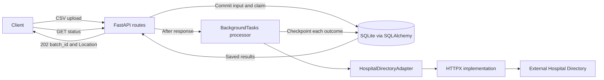
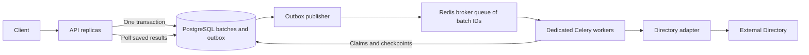

# Hospital Bulk API

A small FastAPI service that validates hospital CSVs, saves a batch, creates inactive records through a separate Hospital Directory API, and activates only a fully confirmed batch. Upload returns `202`; polling delivers the comprehensive result. Read the four-page technical design as a [PDF](output/pdf/hospital-bulk-api-guide.pdf) or [editable Markdown](design_doc.md).



## Run

Use **Python 3.12.14** and [uv](https://docs.astral.sh/uv/getting-started/installation/). From the project root:

```bash
python3.12 -m venv .venv  # Skip if the environment already exists.
uv pip install --python .venv/bin/python -r requirements-dev.txt
.venv/bin/python -m uvicorn app.main:create_app --factory --workers 1
```

Open [API docs](http://localhost:8000/docs) or [health](http://localhost:8000/health). Local startup reads exported environment variables and defaults; it does not load `.env` automatically.

For Docker:

```bash
test -f .env || cp .env.example .env
docker compose up --build -d
docker compose down
```

Compose loads `.env`, uses one non-root application container, and mounts SQLite at `/data/hospitals.db` in the named `hospital_data` volume. `down` retains data; `down --volumes` explicitly deletes it. `PORT` defaults to 8000 and is used by the container command and health check.

All configuration names/defaults are in [.env.example](.env.example) and [app/config.py](app/config.py). Local SQLite defaults to `data/hospitals.db`; keep the container path under `/data`. The defaults are 1 MiB per upload, 20 hospitals, 20 in-flight batches, 5 shared upstream requests/connections, 3 eligible attempts, and connect/read/write/pool timeouts of 10/30/10/5 seconds. Each network attempt also has a 55-second total deadline. Retry sleeps are bounded at 30 seconds; longer `Retry-After` hints stop the automatic loop.

## Deploy on Render

[render.yaml](render.yaml) defines one paid Docker web service (`0.5c-512mb`) with a 1 GB persistent disk mounted at `/data`, `SQLITE_PATH=/data/hospitals.db`, and `/health` monitoring. The existing Dockerfile supplies the build and startup command, including one Uvicorn worker and Render's `PORT`. Other HTTP/limit settings keep the documented application defaults. Automatic deploys are disabled; deploy deliberately when no batch is running.

Create a Blueprint in the [Render dashboard](https://dashboard.render.com/) from this repository and review the paid service/disk before creation. After deployment, verify health, `/docs`, validation-only requests, and a missing-batch `404`; then perform one small intended live upload. Verify that its saved result survives a controlled restart before claiming hosted recovery.

Persistent disks require a paid service and cause a brief stop/start during deployments. Render's free tier has ephemeral storage and does not preserve our batches across restarts. See [persistent disk requirements](https://render.com/docs/disks).

## Use the API

CSV accepts UTF-8/BOM, required `name,address`, and optional string `phone`. Surrounding whitespace is trimmed, blank records are ignored, and duplicate input rows remain separate. Examples: [three hospitals](examples/hospitals.csv), [optional phone](examples/optional_phone.csv), and [missing address](examples/invalid_missing_address.csv).

| Method and path | Result |
| --- | --- |
| `POST /hospitals/bulk/validate` | `204` on valid CSV; no persistence or upstream calls |
| `POST /hospitals/bulk` | `202` with only `batch_id`; status URL in `Location` |
| `GET /hospitals/batch/{batch_id}/status` | `200` with the current seven-field result |
| `POST /hospitals/batch/{batch_id}/resume` | `202` for eligible work, using the same batch UUID |
| `GET /health` | `200` with `{"status":"ok"}` |

Validation-only is a dry run. Upload creates records in the configured Directory.

```bash
BASE_URL=http://localhost:8000
curl -i -F 'file=@examples/hospitals.csv' "$BASE_URL/hospitals/bulk/validate"
curl -i -F 'file=@examples/optional_phone.csv' "$BASE_URL/hospitals/bulk/validate"
curl -i -F 'file=@examples/invalid_missing_address.csv' "$BASE_URL/hospitals/bulk/validate"
```

The first two return `204`; the invalid example returns structured `422` details. Oversized files return `413`. Missing batches return `404`; resume of active/completed/ineligible work returns `409`; full capacity returns `503`; storage failure returns a generic `500`.

Upload once, inspect `Location`, extract the UUID, and poll:

```bash
HEADERS=$(mktemp)
ACCEPTED=$(curl -sS -D "$HEADERS" -F 'file=@examples/hospitals.csv' "$BASE_URL/hospitals/bulk")
cat "$HEADERS"
printf '%s\n' "$ACCEPTED"
BATCH_ID=$(printf '%s' "$ACCEPTED" | .venv/bin/python -c 'import json,sys; print(json.load(sys.stdin)["batch_id"])')
curl -sS "$BASE_URL/hospitals/batch/$BATCH_ID/status"
rm "$HEADERS"
```

If work pauses with eligible failures, unknown outcomes, or pending activation, resume and poll again:

```bash
curl -i -X POST "$BASE_URL/hospitals/batch/$BATCH_ID/resume"
curl -sS "$BASE_URL/hospitals/batch/$BATCH_ID/status"
```

A successful completed batch returns `409` on resume. Polling alone does not restart work.

## Response contract

Acceptance body (illustrative UUID; `Location` is a header):

```json
{"batch_id":"550e8400-e29b-41d4-a716-446655440000"}
```

Completed GET result (illustrative IDs and elapsed time):

```json
{
  "batch_id": "550e8400-e29b-41d4-a716-446655440000",
  "total_hospitals": 3,
  "processed_hospitals": 3,
  "failed_hospitals": 0,
  "processing_time_seconds": 2.41,
  "batch_activated": true,
  "hospitals": [
    {"row": 1, "hospital_id": 101, "name": "General Hospital", "status": "created_and_activated"},
    {"row": 2, "hospital_id": 102, "name": "City Care Hospital", "status": "created_and_activated"},
    {"row": 3, "hospital_id": 103, "name": "Sunrise Hospital", "status": "created_and_activated"}
  ]
}
```

Rows stay in input order. IDs are `null` until confirmed. Public statuses are `pending`, `processing`, `created`, `failed`, `unknown`, and `created_and_activated`. Processed counts include confirmed creations; failed counts include definite row failures, excluding unknown outcomes and activation-only errors. `batch_activated` becomes true only after acknowledgement or complete upstream activation evidence. Timing includes active attempts and excludes idle gaps before resume.

## Verification

```bash
.venv/bin/python -m pytest -q
uvx ruff check app tests scripts
.venv/bin/python -m scripts.benchmark --latency-ms 50
```

The latest full implementation run passed **277 tests**. Processor tests inject fake adapters; integration checks use the concrete HTTPX adapter with a local simulated transport and temporary SQLite. A loopback HTTP test verifies work continues after a client disconnects with a retained UUID. Tests fail on deprecation/future warnings.

Recorded 20-record benchmark at 50 ms per upstream request, including activation:

| Shared concurrency | Completion time | Peak requests | POST / GET / PATCH |
| --- | ---: | ---: | --- |
| 1 | 1.3292 s | 1 | 20 / 0 / 1 |
| 3 | 0.5075 s | 3 | 20 / 0 / 1 |
| 5 | 0.3711 s | 5 | 20 / 0 / 1 |

These are simulation results, including ORM work, not live-service guarantees. In-process `ASGITransport` waits for background completion, so the benchmark measures completion rather than `202` delivery. See [Plan 11](plans/11-integration-and-performance.md) for conditions.

Source repository: [askMohan/paribus-assessment](https://github.com/askMohan/paribus-assessment). Hosted API/docs URLs are pending authenticated Render deployment and verification in Plan 14.

## Design considerations and production path

| Current consideration | Decision and boundary |
| --- | --- |
| Fast acceptance and bounded input | Validate the whole CSV and commit input before `202`; deliver comprehensive results through GET. Limits remain enforced before external creation. |
| One active batch attempt | Atomic SQLite write/state claim; short operation-scoped ORM sessions; no database transaction spans HTTP calls. This is not an exactly-once remote-write guarantee. |
| Safe retries and retained progress | Known-unsent writes and transient reads get bounded jittered retries. `422` is permanent; lost replies, ambiguous `5xx`/`429`, and malformed creation success require reconciliation. Retain inactive successes. |
| Activation and identity | Activate only a fully confirmed manifest. Match unknown records by exact trimmed name/address/phone and quantity; one remote ID cannot satisfy two input rows. |
| Resume and duplicate scope | Skip known IDs, inspect unknowns and uncertain activation, then do only safe remaining work. Identical new uploads create new batches. A field tuple/hash is not a global hospital identity or upstream idempotency key. |
| Restart and timing | One instance/worker with persistent SQLite; startup pauses abandoned work without replay. Discard the uncheckpointed crash interval rather than count downtime, so crash-time duration may be understated. |
| Acceptance gap and disconnect | Work stays in-process, so a crash after commit but before task start needs manual recovery. A disconnected client can poll with its UUID; losing the response and UUID has no idempotency recovery. |

The following is a **production proposal**, not an implemented feature set:



| Production change | Why and how |
| --- | --- |
| Durable queue and separate workers | Move processing to Celery workers with a persisted Redis broker queue of batch IDs. Scale HTTP replicas and job workers independently; each worker owns its client/database resources. Configure acknowledgements, redelivery, and bounded task attempts. [FastAPI guidance](https://fastapi.tiangolo.com/tutorial/background-tasks/), [Celery tasks](https://docs.celeryq.dev/en/stable/userguide/tasks.html). |
| Reliable acceptance and dispatch | Commit the batch and an outbox record together; a publisher delivers jobs to the broker. This closes the database/broker dual-write gap while allowing duplicate delivery. [Transactional outbox](https://docs.aws.amazon.com/prescriptive-guidance/latest/cloud-design-patterns/transactional-outbox.html). |
| Shared state and ownership | Move SQLite to PostgreSQL with migrations/backups and atomic claims plus worker leases/heartbeats. Recover expired ownership; API startup must not interrupt another live worker's jobs. |
| Idempotent recovery | Reuse saved IDs on redelivery, reconcile uncertain writes, and obtain upstream-enforced per-row idempotency keys. Add tenant-scoped upload idempotency for lost acceptance responses. Queue delivery alone does not make external creation exactly once. |
| Fleet-wide load control | Replace the per-process semaphore with a shared upstream rate/concurrency budget. Coordinate cooldowns and backoff; task retries resume checkpoints rather than multiply blind HTTP retries. |
| Security and operations | Add authentication, tenant authorization, TLS/secrets management, retention controls, audit logs, metrics, and alerts for queue age, failed/unknown work, and expired leases. Route exhausted jobs to bounded manual/dead-letter recovery. |

Keep the exact API contract, adapter boundary, per-row checkpoints, and complete-manifest activation rule during this migration.
