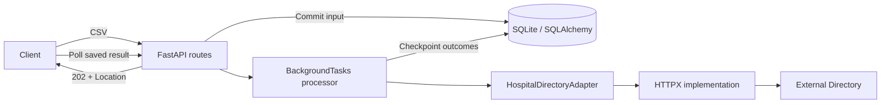
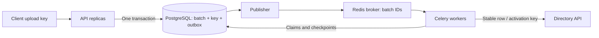

# Hospital Bulk API
## Technical design | Current solution and production evolution

The bulk service owns CSV validation, batch orchestration, checkpoints, and recovery. The external Hospital Directory owns hospital records and activation. We accept a saved batch with `202`; the assignment's comprehensive result is returned by polling. Current implementation is complete through Plan 13; future changes below are proposals.

### 1. Current architecture and execution



| Responsibility | Implementation boundary |
| --- | --- |
| HTTP and validation | `api/routes.py` calls `services/csv_validation.py`; public models in `api/schemas.py` expose only the agreed fields. |
| Workflow | `services/processor.py` claims, creates, settles, and activates; `reconciliation.py` checks uncertain upstream evidence. |
| Persistence and transport | `db/repository.py` uses operation-scoped ORM sessions. The adapter Protocol isolates HTTPX, timeouts, response validation, and safe retries. `main.py` owns shared resources. |

**Execution order:** (1) Validate the entire CSV; invalid input creates nothing. (2) `register_batch` atomically checks capacity and saves the batch plus all input rows. (3) Return `202` and schedule `process_batch` in the same process. (4) `start_attempt` claims `QUEUED -> PROCESSING`. (5) Save `CREATING` before each POST; save the returned ID or failure immediately. Eligible rows run concurrently. (6) Reconcile unknowns; activate only when every row has a confirmed ID. (7) Commit all rows `ACTIVATED` and batch `COMPLETED`. GET reads checkpoints throughout.

### 2. Persisted model and execution guard

| Table / key | Stored columns |
| --- | --- |
| `batches`; PK `batch_id` | `status`, `total_hospitals`, `batch_activated`, `processing_time_seconds`, nullable `attempt_started_at`, nullable `last_error`. |
| `hospital_rows`; PK `(batch_id, row_number)` | `name`, `address`, nullable `phone`, nullable `hospital_id`, `status`, nullable `failure_kind`, nullable `last_error`. `batch_id` is also a foreign key. |

Initially: batch `QUEUED`, activation false, duration zero; rows `PENDING` with no IDs or failures. `(batch_id, hospital_id)` is unique for non-null IDs. Counts are derived from saved rows, not stored twice. No original upload, global identity/hash, or idempotency key is stored.

Claims use a state check inside a short SQLite write transaction (`BEGIN IMMEDIATE`), plus the database's in-process async lock. Only one attempt can claim the batch; duplicate dispatch cannot claim active work. No database transaction spans an HTTP request. This guards local execution, not exactly-once external writes.

**Deployment boundary:** one API instance, one Uvicorn worker, no separate queue/DB service. SQLite is `/data/hospitals.db`, mounted on `hospital_data`; the Directory is external. `BackgroundTasks` runs after the response in the API process, so it is not a durable queue. Compose `down` retains the volume; `down --volumes` deletes it.

<!-- pagebreak -->

### 3. Client and Directory contracts

| Client endpoint | Request and response |
| --- | --- |
| `POST /hospitals/bulk` | Multipart field `file`; `202`, body only `batch_id`, status path in `Location`. Acceptance means input is saved, not creation completed. |
| `POST /hospitals/bulk/validate` | Same file rules; valid `204` with no body, persistence, or upstream calls. |
| `GET /hospitals/batch/{batch_id}/status` | `200` with the seven fields below, including partial results. Polling never restarts work. |
| `POST /hospitals/batch/{batch_id}/resume` | No body; eligible paused work returns the same `202` contract and UUID. Known hospital IDs are retained. |
| `GET /health` | `200`, `{"status":"ok"}`; checks local availability, not Directory readiness. |

**CSV:** UTF-8/BOM, 1-20 nonblank data records, default maximum 1 MiB. Headers are unique and limited to required `name,address` plus optional `phone`. Trim outer whitespace; preserve case, punctuation, phone zeros, order, and duplicate-row multiplicity. Missing/blank phone becomes null. Quoted fields are parsed as CSV.

```csv
name,address,phone
General Hospital,123 Main Street,555-0101
City Care Hospital,45 Park Road,555-0102
Sunrise Hospital,8 Lake Road,555-0103
```

**Acceptance example:** `Location: /hospitals/batch/550e8400-e29b-41d4-a716-446655440000/status`

```json
{"batch_id":"550e8400-e29b-41d4-a716-446655440000"}
```

**Completed GET example:** UUID, hospital IDs, and duration are illustrative.

```json
{
  "batch_id": "550e8400-e29b-41d4-a716-446655440000",
  "total_hospitals": 3, "processed_hospitals": 3, "failed_hospitals": 0,
  "processing_time_seconds": 2.41, "batch_activated": true,
  "hospitals": [
    {"row": 1, "hospital_id": 101, "name": "General Hospital",
     "status": "created_and_activated"},
    {"row": 2, "hospital_id": 102, "name": "City Care Hospital",
     "status": "created_and_activated"},
    {"row": 3, "hospital_id": 103, "name": "Sunrise Hospital",
     "status": "created_and_activated"}
  ]
}
```

IDs remain null until confirmed. Row statuses: `pending`, `processing`, `created`, `failed`, `unknown`, `created_and_activated`. Processed counts confirmed creations; failed counts definite row failures, excluding unknowns and activation-only errors. Timing is active-attempt duration, excluding idle time before resume. Internal batch status and failure kind are not extra response fields.

| Directory operation | Current adapter contract |
| --- | --- |
| Create | `POST /hospitals/`; JSON `name,address,phone,creation_batch_id`; no `active` field or idempotency header. `200` object: `id,name,address,phone,creation_batch_id,active`; require matching input/batch, integer ID, and `active:false`. |
| Inspect / activate | `GET /hospitals/batch/{id}` returns `200` and an array of the same record shape. `PATCH /hospitals/batch/{id}/activate` acknowledges activation with `200`; its body is not used. |

**Errors:** `422` invalid CSV/UUID; `413` oversized file; `404` missing batch; `409` active/completed/ineligible resume; `503` full capacity; `500` storage failure. CSV `detail` is an array of `{message,row,field}`; other route errors use a string. Request-validation errors retain FastAPI's standard format.

<!-- pagebreak -->

### 4. Failure, reconciliation, and resume design

Success path: batch `QUEUED -> PROCESSING -> ACTIVATING -> COMPLETED`; row `PENDING -> CREATING -> CREATED -> ACTIVATED`. Unsuccessful attempts pause as `FAILED`, `RECONCILIATION_REQUIRED`, or `INTERRUPTED`; only eligible paused work can be claimed for resume.

| Evidence / internal kind | Current action |
| --- | --- |
| Connection/pool failure proves request not sent: `retryable` | Adapter may retry within its budget; exhausted creation becomes `FAILED`. Manual resume can retry that row. |
| Explicit upstream validation rejection `422`: `permanent` | Row becomes `FAILED`; retain other successful IDs inactive. Do not resend unchanged rejected input. Permanent-only work cannot resume. |
| Lost/read/write timeout, malformed creation success, ambiguous write `429`/`5xx`: `uncertain` | Row becomes `UNKNOWN`; GET batch evidence before any further mutation. Do not blindly repeat POST/PATCH. |
| Transient GET transport error or `408`/`429`/`5xx` | Safe bounded read retry. Failed/incomplete lookup preserves uncertainty; absence is not proof that creation failed. |

**Network bounds:** one shared client and semaphore (default 5) across batches and all verbs; at most 20 active batches (`QUEUED/PROCESSING/ACTIVATING`). At most 3 total eligible HTTP attempts. Connect/read/write/pool timeouts are 10/30/10/5 seconds; one network attempt also has a 55-second deadline, excluding local semaphore wait. Jittered exponential sleeps release the permit; retry delay cap is 30 seconds. Longer `Retry-After` hints defer automatic retry. The processor adds no second HTTP retry loop.

**Reconciliation rule:** validate batch membership, unique remote IDs, and every known ID's matching input. Match unknown rows by exact trimmed `(name,address,phone)` and quantity; one remote ID cannot fill two rows. An identical-value group needs enough candidates for the whole group. Unexpected, missing, mixed-activation, or conflicting evidence blocks further mutation; unambiguous recovered IDs may still be checkpointed. This tuple is a matching aid, not a unique hospital identity.

**Activation rule:** only a full confirmed manifest can activate. If activation's reply is lost, lookup all records: complete/all-active evidence completes locally; complete/all-inactive evidence allows a later manual activation attempt; mixed or incomplete evidence stays unresolved. One logical activation call per attempt; transport retries remain limited to known-unsent requests.

### 5. Three-hospital walkthrough and saved checkpoints

| Scenario | Database/result and next action |
| --- | --- |
| All three succeed | Save IDs 101/102/103 as `CREATED`; activate; all rows `ACTIVATED`. GET: processed 3, failed 0, activated true. |
| City fails before send | General/Sunrise keep IDs 101/103 as `CREATED`; City `FAILED/retryable`, ID null. GET: 2/1/false. Resume claims the same UUID, skips known IDs, creates City, then activates all three. |
| City is created but its reply is lost | Save City `UNKNOWN/uncertain`. Matching GET evidence adopts its ID without another POST; continue only if reconciliation resolves. If City remains absent, leave it unknown and pause; GET: 2/0/false. |
| City receives `422` | City `FAILED/permanent`; others remain inactive. GET: 2/1/false. If nothing else is eligible, resume returns `409`; no automatic cleanup or input editing. |
| Process stops after a remote write | On startup, active batches become `INTERRUPTED`; abandoned `CREATING` rows become `UNKNOWN`. Retain known IDs and pending input; manual resume reconciles first. No automatic replay. |

Startup keeps checkpointed duration and discards the uncheckpointed crash interval rather than counting downtime; duration can be understated after a crash. A crash between acceptance commit and task start also requires manual resume. A client disconnect does not cancel accepted work while the process remains alive, but the client must retain its UUID.

**Current duplicate boundary:** resume avoids recreating known IDs; identical new uploads create new batches. There is no upload idempotency, global hospital identifier, or upstream idempotency support. Losing `202` and its UUID cannot be safely recovered by uploading again. Verification: 277 tests passed with temporary SQLite and simulated/fake adapters; no live Directory mutations.

<!-- pagebreak -->

### 6. Proposed production design



### Upload idempotency: client -> bulk API

Add optional `Idempotency-Key: <client-generated UUID>` to `POST /hospitals/bulk`; clients reuse it for the same upload. Without a key, preserve today's new-batch behavior. Authenticate first, validate CSV, then hash the canonical ordered normalized manifest, including null phone and duplicate multiplicity; ignore filename and multipart boundaries.

In one transaction, insert a uniquely scoped `(tenant_id, method, route, key)` mapping in `upload_requests` with `payload_hash`, `batch_id`, acceptance status/Location, and expiry policy, together with batch rows and an `outbox` event (`event_id,batch_id,published_at`). The unique constraint serializes simultaneous submissions. Same key + same payload replays the original `202`/UUID/Location, even after completion, without consuming capacity or dispatching again; same key + different payload returns `409`. Invalid input does not reserve a key; a rolled-back admission failure leaves no mapping. Keep mappings through the documented retry horizon and at least the active job lifetime; expired mappings lose the guarantee.

### Hospital idempotency: worker -> Directory

Before the first create, persist a stable per-row operation key, for example `create:{batch_id}:{row_number}` (namespaced per caller). Extend the adapter to receive/send it as `Idempotency-Key` on `POST /hospitals/`; retries, resume, and queue redelivery reuse the same key and immutable payload. Row number distinguishes identical CSV rows. Add nullable `creation_idempotency_key` to row storage during migration; populate before any new write.

**Required upstream change:** Directory must atomically enforce key uniqueness with hospital creation, retain the key-to-ID/result mapping through the recovery window, replay the same result for the same payload, and reject mismatched payloads. A local key/header alone cannot prevent duplicates after a lost reply. Until this contract exists, keep conservative reconciliation. Reconcile legacy unknown writes before enabling keyed replay. These keys prevent repeated operations; cross-batch real-world hospital deduplication still needs a trusted business identifier.

For activation, request documented repeat-safe activation or a stable `activate:{batch_id}` key enforced upstream. Resume retains the original batch and row keys; it never generates replacement keys for retries. Example: client retries upload key U -> same batch B; worker loses City's reply and retries `create:B:2` -> same remote ID, even if the hospital was already committed.

### Reliable dispatch, ownership, and operations

| Change | Concrete approach |
| --- | --- |
| Queue and dispatch | Replace `BackgroundTasks` with dedicated Celery workers and a persistence-configured Redis broker. Publish only batch IDs from the committed outbox; mark delivered after broker acknowledgement. A publisher crash may redeliver, so consumers remain idempotent. [1-3] |
| State and ownership | Move SQLite to PostgreSQL with migrations/backups. Claim jobs atomically with renewable leases/heartbeats and version checks that reject stale checkpoints. Recover expired owners; API startup must not interrupt live workers. A lease alone cannot fence a stale external write. |
| Retry and load | Configure late acknowledgements/worker-loss redelivery, bounded attempts, and visibility deadlines. Acknowledge after saved outcomes/retry decisions. Workers own their async client/DB lifecycle; share fleet-wide upstream limits/cooldowns. Resume checkpoints; route exhausted jobs to manual/dead-letter recovery. [2] |
| Security and observability | Add auth/tenant authorization, TLS/secrets, retention, audit logs, and metrics/alerts for queue age, unknown failures, and expired leases. Keep the seven-field GET contract, per-row checkpoints, and activation barrier. |

References for the proposed infrastructure: [1 FastAPI BackgroundTasks](https://fastapi.tiangolo.com/tutorial/background-tasks/), [2 Celery task delivery](https://docs.celeryq.dev/en/stable/userguide/tasks.html), [3 Transactional outbox](https://docs.aws.amazon.com/prescriptive-guidance/latest/cloud-design-patterns/transactional-outbox.html). Idempotency semantics above are our proposed contract, not a capability claimed for the current Directory.
